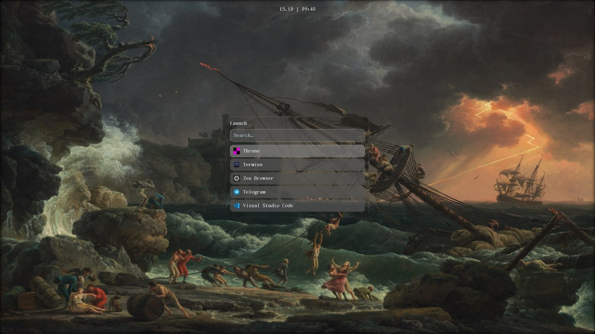
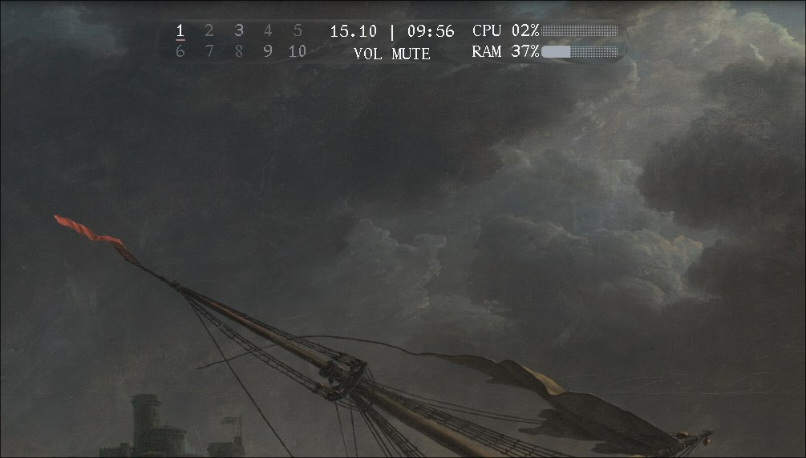

# Dynis

A Dynamic Island for **Hyprland**, built with **Quickshell**, QML, and Qt 6. A compact clock that expands into media controls, notifications, workspace previews, and system status.

Includes a searchable app launcher, clipboard picker, per-monitor workspace strip, CPU/RAM graphs, and separate glass surfaces for the island and launcher.



*Application launcher with keyboard navigation and usage-based ranking.*



*Workspace indicators, clock, volume, and CPU/RAM history.*

## Features

- Animated island with clock, horizontal swipe views, volume/brightness feedback, and recording indicator
- MPRIS media controls, cover art, synced lyrics, and optional CAVA visualization
- Desktop notifications with application icons and image previews
- Per-monitor workspace strip and window overview
- Wi-Fi and Bluetooth views with network selection and pairing controls
- Searchable launcher using desktop entries, plus a cliphist clipboard picker
- Status preview while holding Super, fullscreen-aware visibility, rounded screen corners
- Live JSON configuration and bundled Xanh Mono / Symbols Nerd Font

## Installation

Requires a Hyprland session, Quickshell, CMake 3.16+, a C++17 compiler, pkg-config, **Qt 6 development packages**, **libudev**, and **GIO / gio-unix-2.0** development files. Qt modules: Core, Gui, Qml, Network, DBus, Test, Concurrent. Quickshell needs its Hyprland, Wayland, Bluetooth, MPRIS, and Notifications modules.

System integrations use `hyprctl`, `wpctl`, `pactl`, `brightnessctl`, UPower, and BlueZ. Optional: NetworkManager or iwd, CAVA, ImageMagick, `cliphist` / `wl-clipboard`, and TLP with polkit and a session authentication agent.

```bash
git clone https://github.com/fanat-sira/dynis.git
cd dynis
./scripts/install-fonts.sh
cmake -S . -B build-release -DCMAKE_BUILD_TYPE=Release -DCMAKE_INSTALL_PREFIX=/usr
cmake --build build-release -j2
ctest --test-dir build-release --output-on-failure
```

Try the checkout:

```bash
BUILD_DIR="$PWD/build-release" QUICKSHELL_LYRICS_BACKEND="$PWD/build-release/lyricsmpris" ./run-local.sh
```

Or install and start the user service:

```bash
sudo cmake --install build-release
systemctl --user daemon-reload
systemctl --user enable --now dynis
```

Use the `/usr` installation prefix. Stop an existing Dynis instance and any other notification daemon before starting it.

The optional [Debian/Ubuntu installer](scripts/install-debian-ubuntu.sh) can install dependencies and build a pinned Quickshell revision. Review it first; run `./scripts/install-debian-ubuntu.sh --help` for options.

## Basic setup

Run `/usr/share/dynis/bin/dynis-setup --wizard`, or copy [the example config](config/userconfig.example.json) to `~/.config/dynis/userconfig.json`. Dynis watches changes automatically. Left-click opens the player; right-click toggles the workspace overview in the default configuration.

Example Hyprland bindings, assuming `$mainMod = SUPER`:

```conf
bind = ALT, SPACE, exec, qs ipc -p /usr/share/dynis call dynis launcher
bind = $mainMod, V, exec, qs ipc -p /usr/share/dynis call dynis clipboard
bind = $mainMod, TAB, exec, qs ipc -p /usr/share/dynis call overview toggle
bind = $mainMod, M, exec, qs ipc -p /usr/share/dynis call dynis togglePlayer
bind = $mainMod, SUPER_L, exec, qs ipc -p /usr/share/dynis call dynis mainModDown
bindr = $mainMod, SUPER_L, exec, qs ipc -p /usr/share/dynis call dynis mainModUp
```

For a checkout, use its absolute path in place of `/usr/share/dynis`.

See [configuration and desktop integration](docs/configuration.md) for fonts, glass effects, clipboard collection, and more bindings.

## Known limitations

- Screenshot wallpapers and compositor plugins are not bundled. Refraction requires a compatible glass plugin; without it, the surfaces remain near-transparent.
- Notifications do not support inline replies, advertised actions, or persistent history.
- Synced lyrics depend on external providers and track matching. The lyrics helper sends track metadata to those providers.
- Clipboard collection must be configured separately through cliphist.
- Legacy control-center click actions return to the resting view. Existing custom configurations keep their selected action; use `toggleOverview` or `toggleLyrics` to replace it.
- Setup's automatic binding editor targets `hyprland.conf` syntax. Other configuration formats require manual bindings.

## Development

The Qt backend lives in [`backend/`](backend/), the interface in root QML files and [`qml/`](qml/), and the lyrics helper in [`lyricsmpris/`](lyricsmpris/).

```bash
cmake --build build-release -j2
ctest --test-dir build-release --output-on-failure
git diff --check
```

Restart Quickshell after backend changes. CI builds the project, runs the Qt tests, and checks installation files. See [development and packaging](docs/development.md) for release preparation and test coverage.

## License

[MIT](LICENSE). See [third-party notices](THIRD_PARTY_NOTICES.md) for source attribution. Bundled fonts retain their [own licenses](fonts/).
